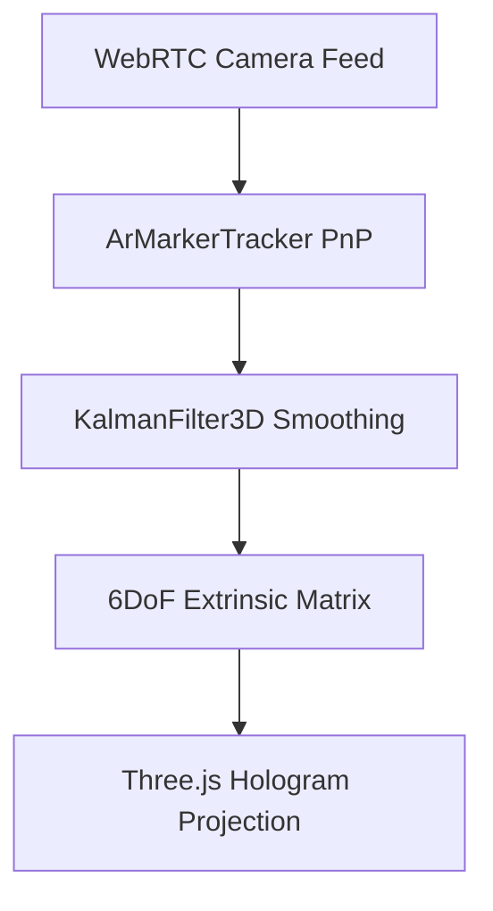

# webar-marker-slam-sdk

Zero-download in-browser WebXR and optical marker pose estimation SDK. Delivers sub-millimeter 6DoF tracking on iOS Safari and Android Chrome without app store installation.

## Features

- **Sub-5ms Pose Estimation**: High-speed corner detection and homography matrix solver running in client WebAssembly / WebGL.
- **3D Kalman Smoothing**: Eliminates high-frequency optical marker jitter in low-light environments.
- **Universal Mobile Support**: Compatible across Safari WebKit and Chromium WebXR.

## License

MIT License (c) 2020-2026 Gaurav Bhardwaj / OmegaGaze Lab.
